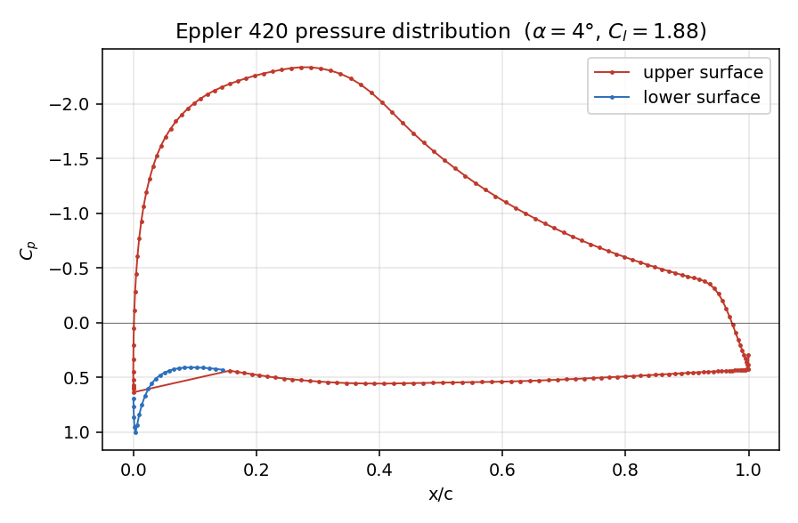
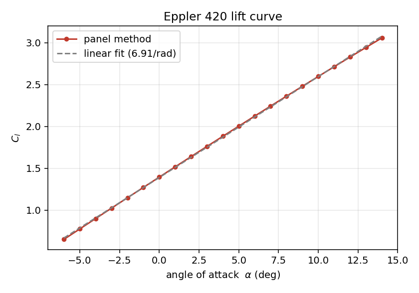
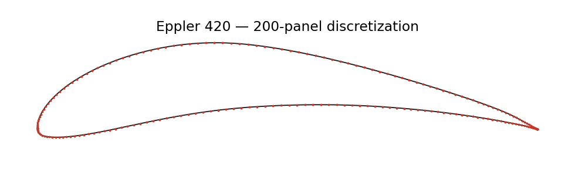

# Airfoil Aerodynamics with a Vortex-Panel Method (MATLAB)

Inviscid, incompressible aerodynamic analysis of the **Eppler E420** high-lift airfoil using a **linear-strength vortex-panel method** written from scratch in MATLAB. The solver computes the surface pressure distribution $C_p(x/c)$ and the lift curve $C_l(\alpha)$, and is validated against thin-airfoil theory on the NACA 0012.

This project provides the aerodynamic baseline for my work on [auxetic structures for morphing wings], which uses the same Eppler E420 section.

<p align="center"></p>

## Method

The airfoil surface is discretised into $N$ flat panels, each carrying a vortex sheet whose strength varies **linearly** between its end nodes (Kuethe & Chow formulation):

1. **Geometry.** Coordinates are split at the leading edge and each surface is re-sampled with **cosine spacing**, clustering panels near the leading and trailing edges where gradients are steepest. A single sharp trailing-edge node closes the contour.
2. **Flow tangency.** At every panel midpoint the normal velocity induced by all panels plus the freestream is set to zero, giving $N$ equations in $N+1$ nodal vortex strengths.
3. **Kutta condition.** $\gamma_1 + \gamma_{N+1} = 0$ ensures smooth flow off the trailing edge and closes the system.
4. **Post-processing.** Tangential surface velocity gives $C_p = 1 - (V/V_\infty)^2$; total circulation gives $C_l$ through the Kutta–Joukowski theorem.

## Results

| Case | $C_l$ at $\alpha=0°$ | Lift-curve slope | Expected |
|---|---|---|---|
| **NACA 0012** (validation) | 0.000 | 6.91 /rad (0.121 /deg) | 0 and ≈ 2π /rad (+~10 % for thickness) |
| **Eppler E420** | **+1.40** | 6.9 /rad | large positive $C_{l,0}$ — highly cambered high-lift section |

At $\alpha = 4°$ the E420 reaches $C_l = 1.88$, with an upper-surface suction peak of $C_p \approx -2.3$ near $x/c \approx 0.28$.

<p align="center">


</p>

## Numerical issues found and fixed

Two problems came up during development and are worth recording:

- **Trailing-edge $C_p$ spike.** Applying cosine spacing around the *whole* contour double-clustered points at the trailing edge, creating panels ~10⁻⁴ c long and a spurious $C_p \approx -1300$. Re-sampling **each surface separately** with a shared sharp TE node removed it ($|C_p|_{max}$ = 2.33, lift unchanged).
- **Panel orientation.** The influence coefficients assume a **clockwise** contour; the Selig `.dat` file is counter-clockwise, so `loadAirfoil.m` reverses it. Using the wrong orientation silently produces wrong lift.

## Limitations

This is a potential-flow model: it neglects viscosity, so it **does not predict stall, drag, or boundary-layer separation**, and $C_l$ keeps rising linearly with $\alpha$. It is accurate for pre-stall lift and pressure distribution; coupling it to a boundary-layer solver (as XFOIL does) would be the natural next step.

```

## Files

| File | Purpose |
|---|---|
| `runAirfoil.m` | Main script: pressure distribution and lift-curve sweep |
| `panelMethod.m` | Vortex-panel solver (influence coefficients, Kutta condition, $C_p$, $C_l$) |
| `loadAirfoil.m` | Reads a Selig `.dat` file and re-panels it with cosine spacing |
| `validateNACA0012.m` | Validation case |
| `eppler420.dat` | Eppler E420 coordinates (Selig format) |
| `figures/` | Reference output figures |

## References

1. A. M. Kuethe and C.-Y. Chow, *Foundations of Aerodynamics*, 5th ed., Wiley, 1998.
2. J. Katz and A. Plotkin, *Low-Speed Aerodynamics*, 2nd ed., Cambridge University Press, 2001.
3. J. D. Anderson, *Fundamentals of Aerodynamics*, 6th ed., McGraw-Hill, 2017.

## Author

**Zahin Tasnim Ridita** — B.Sc. Industrial & Production Engineering, Islamic University of Technology (IUT), Bangladesh
Interests: auxetic metamaterials, additive manufacturing, FEA, morphing structures.
